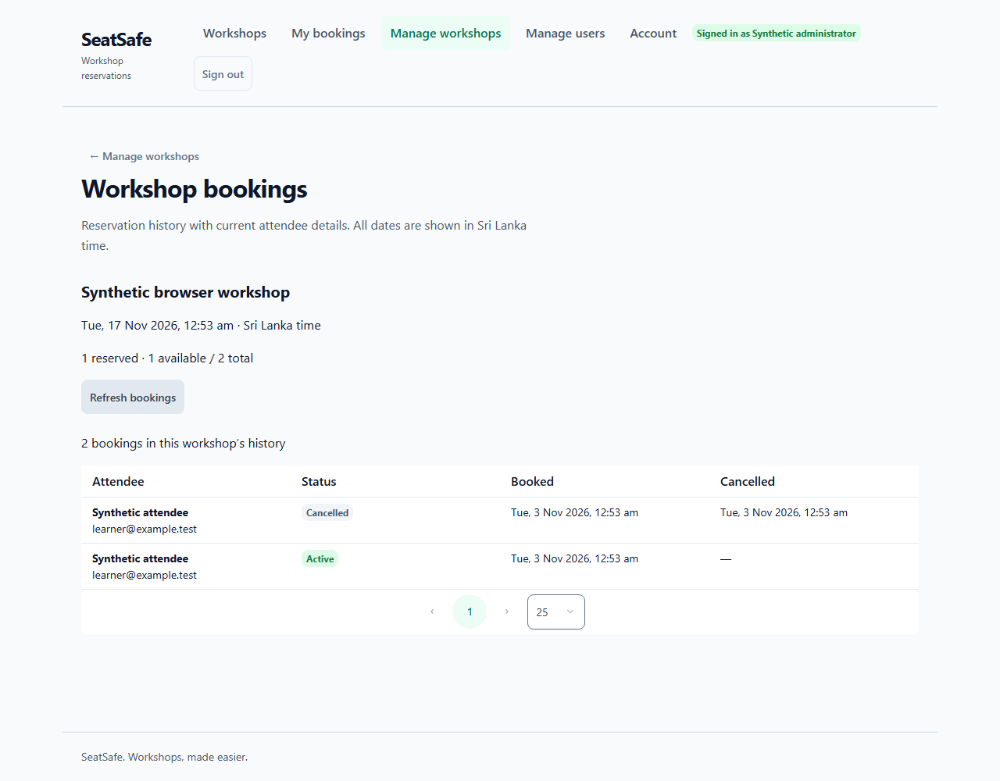
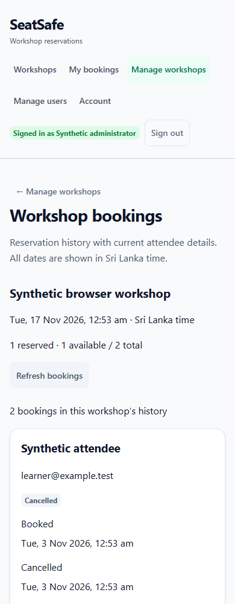
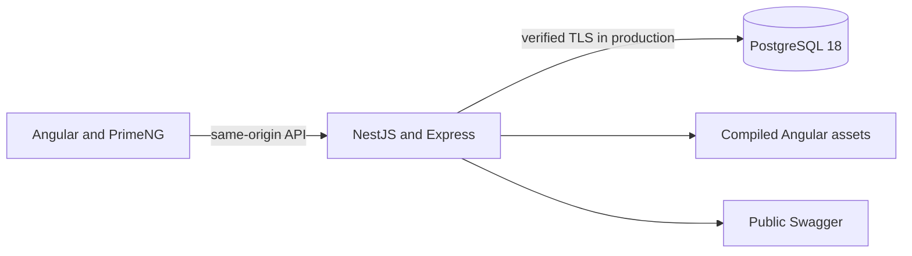

# SeatSafe

A workshop booking application built to explain reliable reservations, recoverable browser sessions and administrator workflows through working features.

**Release status:** the Phase 29 release package is implemented locally. Neon PostgreSQL 18 in Singapore is connected over verified TLS, with all six migrations applied and an isolated application journey verified. Public Render deployment, hosted acceptance checks and live links are pending. This is not yet a verified live release.

## Features

- Workshop browsing with Asia/Colombo schedules.
- Registration, login, cross-tab session restoration and logout.
- One-seat reservations, reload-safe request keys, booking history and repeat-safe cancellation.
- Administrator workshop management, read-only attendee history, account search and USER disabling with session revocation.
- Development-only reliability lab using synthetic fixtures in disposable schemas. Disabled in production.
- Public Swagger; protected operations retain authentication and current database role checks.



<details><summary>Mobile attendee history</summary>



</details>

## Architecture and correctness



Angular uses standalone components, reactive forms, HttpClient/RxJS and signals. PrimeNG **22.1.2**, light Aura and green styling provide consistent controls. Nest uses TypeORM with **six explicit migrations**, synchronization disabled.

Reservation transactions lock user then workshop, recheck eligibility, insert a booking and increment the counter together. Partial uniqueness prevents two ACTIVE bookings per account/workshop. Account-scoped request keys save committed success and business-error snapshots. Cancellation releases a seat once and retains history.

Passwords use Argon2id. Fifteen-minute HS256 tokens remain in private tab memory; seven-day sessions and hashed opaque refresh credentials live in PostgreSQL. Refresh cookies are HttpOnly, SameSite=Lax, host-only and Secure in production. Strict reuse detection revokes a session when a consumed refresh credential is replayed. Web Locks serialize cookie changes across tabs; BroadcastChannel carries credential-free lifecycle notices. Backend guards read current account/session/role state. Enabling an account requires fresh login and never restores revoked credentials.

## Local setup

Use **Node 24.22.1**, **npm 12.2.0** and PostgreSQL 18. On Windows the existing helper selects an installed compatible runtime:

```powershell
. .\scripts\use-node.ps1
npm ci --prefix api
npm ci --prefix web
Copy-Item api/.env.example api/.env
```

Do not replace an existing environment file. Fill ignored API settings privately with your PostgreSQL connection and a random JWT secret of at least 32 bytes. Configure PrimeNG privately in ignored `web/public/primeui-license.local.json`, a JSON object with a `license` property. Never commit these values.

```powershell
npm run db:migration:run --prefix api
npm run db:seed --prefix api
npm run start:dev --prefix api
# In another runtime-activated terminal:
npm start --prefix web
```

Frontend: `http://localhost:4200`. Swagger: `http://localhost:3000/swagger`. Health: `/api/health`. The Angular proxy keeps API requests same-origin. Registration creates USER accounts without signing in. Run `npm run db:seed:admin --prefix api` interactively for a private local administrator; passwords are hidden and reruns never promote/reset an existing USER.

## Verification

```powershell
npm run build --prefix api
# From api/: npx tsc --noEmit; npm run lint
npm test --prefix api
npm run test:e2e --prefix api
npm run test:db --prefix api
npm run test:race --prefix api
npm test --prefix web -- --watch=false
npm run build --prefix web
# Once from api/: npx playwright install chromium
npm run test:browser --prefix api
npm run test:release --prefix api
```

Suites use owned disposable schemas, compare development/private fingerprints and fail on cleanup/preservation problems. Browser journeys use real APIs with interception only for deliberate transport faults. No saved authentication state, traces, video or network-payload attachments.

New Phase 29 observations: **265 backend unit, 279 mocked HTTP, 241 PostgreSQL, 264 Angular and 12 desktop/mobile browser tests passed**. The final rebuilt compiled-server browser check also passed: **1,062 tests in total**. The release initial bundle is **447.47kB**, under the unchanged 500kB warning budget. The focused race command passed **47 cases already included in PostgreSQL totals**. Phase 28's 1,019 total is historical.

The **100-user HTTP reservation experiment** produced one 201, 99 WORKSHOP_FULL, zero unexpected/transport/timeout outcomes and one ACTIVE booking/reserved seat. The unchanged unsafe test-only control accepted two internal attempts for one seat while storing a counter of one. Local lab runs use **internal service attempts**, not HTTP requests. These prove specific correctness properties, not throughput or latency. Never load-test the free hosted service.

## Release and deployment

```powershell
npm run build:release --prefix api
npm run start:release --prefix api
```

The release build compiles both apps, copies Angular to `api/dist/client` and generates only the ignored licence artifact from private configuration. Production fails if the frontend entry is absent. Nested HTML navigation supports reloads; API/Swagger routes remain backend routes; missing assets return 404. Fingerprinted JS/CSS is cached immutably; HTML/licence configuration remains refreshable. The 500kB initial warning budget is unchanged.

[`render.yaml`](render.yaml) defines one free manually deployed service: Node 24.22.1, pinned npm build, provider PORT, bind 0.0.0.0, health /api/health. Use a separate Neon PostgreSQL 18 database and direct endpoint with `DB_SSL=true`, certificate verification and a five-connection pool. Supply private database values, strong JWT secret, exact hosted HTTPS origins and PRIMENG_LICENSE through provider configuration. Lab execution stays disabled. The proxy hop setting requires actual forwarding-chain and spoofing verification before hosted acceptance; unrestricted trust is never enabled.

Privately copy `api/.env.production.example` to ignored `api/.env.production.local`, enter hosted database settings, then run locally:

```powershell
npm run db:migration:show:production --prefix api
npm run db:migration:run:production --prefix api
npm run db:seed:admin:production --prefix api
```

Database commands require no JWT/origin settings. Migrations never run during build/start. Bootstrap requires an interactive terminal, explicit production confirmation and hidden password confirmation; it creates no session. These commands rebuild Nest output: rebuild the release before another local compiled frontend start.

For Neon CLI onboarding, install/login privately, then link an existing project with PostgreSQL only. This project now includes `neon.ts` and pinned root development tooling (`npm ci --ignore-scripts`). Root `npm run build` builds the full release. Neon context `.neon` and pulled `.env.local` stay ignored. After a PostgreSQL environment pull, `npm run neon:database:configure` maps `DATABASE_URL_UNPOOLED` into a **new**, ignored `api/.env.production.local` with certificate-verified TLS. It refuses to replace an existing file; never use it to overwrite local `api/.env`. Render application traffic uses the agreed bounded direct connection, while database commands use the same direct endpoint.

The Neon continuation additionally passed **25 HTTP checks** against a locally started compiled application using an owned disposable schema on the real hosted database. They covered authentication, refresh/logout, administrator operations, reservation/replay/cancellation/rebooking and role denial. The fixture was removed and hosted public/local development/private snapshots matched. This is separate evidence from the 1,062 regression tests above, and does not prove a public Render deployment or production browser cookie/proxy behavior.

Create future demo workshops through the admin UI. Verify register/login/reload/reserve/history/cancel/rebook/logout, administrator features, origin/cookie/proxy behavior and restart persistence before publishing live links. Provider sign-in/private entry remains a user step.

Render's free service sleeps after inactivity, has resource/build/outbound limits and no shell/one-off jobs. Local disk is ephemeral; PostgreSQL stores persistent state. See [free service limits](https://render.com/docs/free) and [web service requirements](https://render.com/docs/web-services). This is a hobby/interview demo.

For recovery, check health and safe provider/application logs without sharing credentials or payloads. Export PostgreSQL privately with `pg_dump` using protected connection settings; test restoration into a separate database. Roll back application code to a verified compatible deployment while retaining data. Never automatically reverse hosted migrations or reset rows.

## CI and limitations

GitHub Actions builds, checks types/lint/formatting and runs unit/HTTP/PostgreSQL/Chromium suites using disposable PostgreSQL 18 and public test credentials. Configure private repository secret `PRIMENG_LICENSE`; cloud credentials are not used in CI. The fixture writer refuses non-CI use/existing private files. Failure artifacts are restricted to safe browser screenshots. Remote CI verification remains pending.

Runtime audit: **zero high/critical**, with three moderate backend findings through TypeORM's glob/minimatch tooling path. Entity/migration paths are fixed application configuration; clients supply no glob patterns. No forced fix or TypeORM major upgrade was used. Frontend audit reported zero findings. Review advisories again for later releases.

In-memory throttling and lab reports target one API instance. Lost refresh responses can trigger strict reuse revocation; the browser avoids automatic ambiguous retries. Actual 200% zoom and OS reduced-motion verification remain pending, distinct from browser emulation. Earlier learning reviews and Phase 24's historical preservation gap remain documented privately.

Original Phases 30–31 are consolidated into final Phase 29. Local implementation, verified live deployment and the final learning review remain separate milestones.
